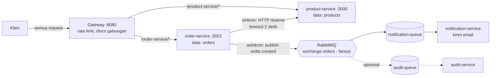

# Toko: Microservices untuk Mata Kuliah Web Service (Lab 09-11)

Aplikasi toko sederhana (produk + pesanan) yang dipecah menjadi beberapa service dengan data
masing-masing, dipasang di belakang API Gateway. order-service memanggil product-service secara
sinkron untuk mengurangi stok (lab 09), menerbitkan event `order.created` lewat RabbitMQ yang
dikonsumsi notification-service (lab 10), dan setiap service mendokumentasikan dirinya sendiri
dengan OpenAPI yang digabungkan di gateway (lab 11).

## Struktur repository

```
toko-lab09/
├── latihan-monolith/          monolit awal (lab 09, hanya untuk latihan)
├── toko/
│   ├── gateway/               API gateway: routing, rate limiting, dokumentasi gabungan
│   ├── product-service/       pemilik data produk & stok
│   ├── order-service/         pemilik data pesanan, publisher event order.created
│   ├── notification-service/  consumer event order.created (kirim email simulasi)
│   └── smoke-test.js          uji end-to-end lewat gateway
└── openapi.json               spesifikasi gabungan hasil gateway
```

## Cara menjalankan

Prasyarat: Node.js 18+. Docker hanya dibutuhkan untuk RabbitMQ (lab 10); tanpa RabbitMQ,
order-service tetap berjalan dan hanya menampilkan peringatan di log.

1. Jalankan `npm install` sekali di tiap folder service dan gateway.
2. (Opsional) RabbitMQ:
   `docker run -d --name rabbit -p 5672:5672 -p 15672:15672 rabbitmq:3-management`
3. Nyalakan berurutan, masing-masing di terminal sendiri:

| Urutan | Service | Port | Perintah (dari folder `toko`) |
|---|---|---|---|
| 1 | product-service | 3000 | `cd product-service && node product-service.js` |
| 2 | notification-service (opsional) | - | `cd notification-service && node notification-service.js` |
| 3 | order-service | 3001 | `cd order-service && node order-service.js` |
| 4 | gateway | 8080 | `cd gateway && node gateway.js` |

4. Uji cepat: `node smoke-test.js` dari folder `toko`.

## Dokumentasi API

| Alamat | Isi |
|---|---|
| http://localhost:8080/docs | Swagger UI gabungan semua service (pakai ini untuk Try it out) |
| http://localhost:8080/openapi.json | spesifikasi gabungan |
| http://localhost:3000/docs | dokumentasi product-service saja |
| http://localhost:3001/docs | dokumentasi order-service saja |

File `openapi.json` di akar repo adalah salinan spesifikasi gabungan dan bisa diimpor ke Postman.

## Environment variable

| Variabel | Dipakai di | Default | Fungsi |
|---|---|---|---|
| `PORT` | product-service, order-service, gateway | 3000 / 3001 / 8080 | port tiap service |
| `PRODUCT_SERVICE_URL` | order-service, gateway | `http://localhost:3000` | alamat product-service |
| `ORDER_SERVICE_URL` | gateway | `http://localhost:3001` | alamat order-service |
| `PRODUCT_DOC_URL` | gateway | `http://localhost:3000/openapi.json` | sumber dokumentasi product-service |
| `ORDER_DOC_URL` | gateway | `http://localhost:3001/openapi.json` | sumber dokumentasi order-service |
| `AMQP_URL` | order-service, notification-service | `amqp://localhost` | alamat RabbitMQ |

Kredensial (misalnya `AMQP_URL` ke broker cloud) tidak disimpan di repository.

## Arsitektur



## Batas service

| Service | Data yang dimiliki | API / event | Interaksi dengan service lain |
|---|---|---|---|
| product-service | `products` (nama, harga, stok) | `GET /products`, `GET /products/:id`, `POST /products/:id/reserve` | dipanggil order-service secara sinkron saat `POST /orders` |
| order-service | `orders` (pesanan + salinan nama/harga) | `POST /orders`, `GET /orders`; menerbitkan event `order.created` | memanggil `reserve`, lalu publish event tanpa menunggu consumer |
| notification-service | daftar `messageId` yang sudah diproses (memori) | consumer `notification-queue` | menerima event `order.created` dari exchange `orders` |