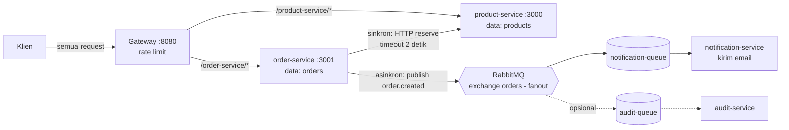

# Toko: Lab 09-10, Microservices + Message Queue

Aplikasi toko (produk + pesanan) yang dipecah menjadi beberapa service dengan data masing-masing,
dipasang di belakang API Gateway (lab 08). Lab 10 menambahkan komunikasi asinkron lewat RabbitMQ:
order-service menerbitkan event `order.created`, notification-service mengonsumsinya.

## Struktur

```
toko/
├── gateway/                API gateway (port 8080): routing + rate limiting
├── product-service/        pemilik data produk & stok (port 3000)
├── order-service/          pemilik data pesanan (port 3001), publisher event
├── notification-service/   consumer event order.created (kirim email simulasi)
└── smoke-test.js           uji end-to-end lewat gateway
```

## Arsitektur



## Batas service

| Service | Data yang dimiliki | API / event | Interaksi dengan service lain |
|---|---|---|---|
| product-service | `products` (nama, harga, stok) | `GET /products`, `GET /products/:id`, `POST /products/:id/reserve` | dipanggil order-service secara sinkron saat `POST /orders` |
| order-service | `orders` (pesanan + salinan nama/harga) | `POST /orders`, `GET /orders`; menerbitkan event `order.created` | memanggil `reserve`, lalu publish event tanpa menunggu consumer |
| notification-service | daftar `messageId` yang sudah diproses (memori) | consumer `notification-queue` | menerima event `order.created` dari exchange `orders` |

## Menjalankan

1. RabbitMQ: `docker run -d --name rabbit -p 5672:5672 -p 15672:15672 rabbitmq:3-management`
   (dashboard di http://localhost:15672, user/password `guest`). Alamat broker lain bisa diisi
   lewat environment variable `AMQP_URL`; jangan simpan kredensialnya di repository.
2. Di tiap folder service jalankan `npm install` sekali.
3. Nyalakan berurutan (notification-service lebih dulu agar antreannya terikat ke exchange):

```bash
cd product-service      && node product-service.js       # terminal 1
cd notification-service && node notification-service.js  # terminal 2
cd order-service        && node order-service.js         # terminal 3
cd gateway              && node gateway.js               # terminal 4
node smoke-test.js                                       # terminal 5 (folder toko)
```