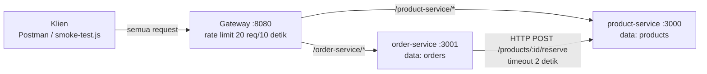

# Toko: Lab 09, Memecah Monolit menjadi Microservices

Aplikasi toko (produk + pesanan) yang dipecah menjadi dua service dengan data masing-masing,
dipasang di belakang API Gateway dari lab 08.

## Struktur

```
toko/
├── gateway/           API gateway (port 8080): routing + rate limiting
├── product-service/   pemilik data produk & stok (port 3000)
├── order-service/     pemilik data pesanan (port 3001)
└── smoke-test.js      uji end-to-end lewat gateway
```

## Arsitektur



## Batas service

| Service | Data yang dimiliki | API yang ditawarkan | Dipanggil oleh |
|---|---|---|---|
| product-service | `products` (nama, harga, stok) | `GET /products`, `GET /products/:id`, `POST /products/:id/reserve` | order-service, saat `POST /orders` perlu mengurangi stok |
| order-service | `orders` (pesanan + salinan nama/harga saat transaksi) | `POST /orders`, `GET /orders` | klien, lewat gateway |

Aturan utama: order-service tidak membaca data produk secara langsung; ia bertanya lewat API product-service.

## Menjalankan

Buka empat terminal. Di tiap folder service dan gateway jalankan `npm install` sekali, lalu:

```bash
cd product-service && node product-service.js   # terminal 1
cd order-service   && node order-service.js     # terminal 2
cd gateway         && node gateway.js           # terminal 3
node smoke-test.js                              # terminal 4 (di folder toko)
```
